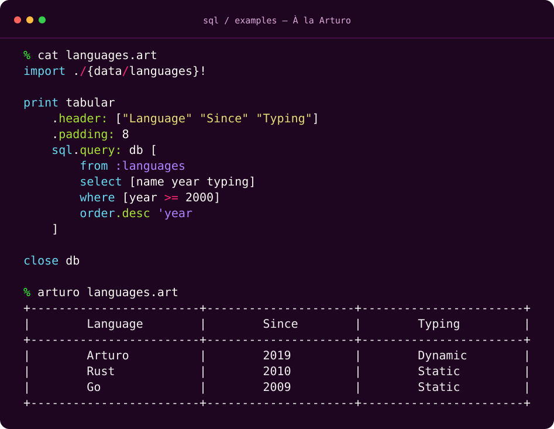

<h1 align="center"><i><b>SELECT</b> sql <b>AS</b> "À la Arturo"<b>;</b></i></h1>

<p align="center">
    <i>Build queries with expression.</i>
    <br><br><br>
    
    
    <br>
    <b>~ CODE IS ART ~</b>
    <br><br>
</p>

<p align="center">
    <a href="https://www.arturo-lang.io"></a>
    &nbsp;
    <a href="https://github.com/RickBarretto/pkgr.sql.art/blob/main/LICENSE"></a>
    &nbsp;
    <a href="https://github.com/RickBarretto/pkgr.sql.art/actions"></a>
</p>

Build SQL with Arturo blocks, inspect the statement, and compile it for SQLite
or PostgreSQL. Execute SQLite queries through Arturo's native database connection,
or pass compiled SQL and parameters to your own driver.

- **Composable queries:** filters, joins, aggregates, subqueries, CTEs and set operations.
- **Schema and writes:** create and alter tables, insert rows, update, delete, views and triggers.
- **Parameterized output:** quoted identifiers and separate SQL text and values.
- **Inspectable statements:** build once and choose the target dialect when compiling.

Requires **Arturo 0.10.0+**. PostgreSQL support generates SQL; execution uses an
external driver. See [dialect selection](#dialect-selection) for supported features.

[Quick start](#quick-start) · [API reference](api/API.md) ·
[Examples](examples/) · [Development](#development) · [License](#license)

## At a Glance

<p align="center">
    
</p>

Query programming languages with SQLite and format the results with `tabular`.
Run the complete example with `arturo examples/languages.art`.

## Installation

```sh
arturo -p install sql
```

Then import it in your Arturo script:

```art
import {sql}!
```

## Quick start

Build a query and compile it without opening a database:

```art
import {sql}!

minimumAge: 18
statement: sql [
    from :users
    select [id name]
    where [age >= (minimumAge)]
    order 'name
    limit 20
]

compiled: to :sqliteQuery statement
print compiled\text
inspect compiled\params
```

Parentheses capture Arturo values when the statement is built. Compilation returns
SQL in `compiled\text` and bind values in `compiled\params`; it does not execute
the query. To run it against SQLite, use `sql.query: db statement` with an open
connection. See [execution and terminal tables](#execution-and-terminal-tables)
for a complete example with connection cleanup.

To try the checked-in examples from a local checkout:

```sh
arturo src/main.art
arturo examples/sqlite.art
arturo examples/postgres.art
```

## Documentation

An SQL builder for Arturo 0.10.0+, using the function API in [api/API.md](api/API.md).
Every DSL command belongs inside `sql [...]`. Bodies are captured as SQL data;
helpers do not replace Arturo's built-in functions.

```art
import {sql}!

minimumYear: 2020
statement: sql [
    from :books
    select [title publishedYear]
    where -> and publishedYear >= (minimumYear) available = true
    order.desc 'publishedYear
    order 'title
    limit.skip: 0 20
]
compiled: to :sqliteQuery statement
inspect compiled\text
inspect compiled\params
```

`sql` returns an inspectable dictionary. `to :sqliteQuery` produces `text` and
`params` without executing SQL or mutating the statement. Values use `?` parameters;
booleans use SQLite integer values. Renderer-local adapters add numeric casts
where scalar expressions lack column affinity, and preserve SQL nulls on Arturo
runtimes that bind parameters as text. These helpers do not replace native Arturo
functions and leave scope after rendering. Parenthesized Arturo computations run once during
construction, including computations using function-local variables.

Tables, columns and aliases accept types, literals, strings, paths, literal paths,
and captured words. Prefer `:books` for tables and `'title` for single columns.
Identifiers are quoted; strings inside predicates, expressions and rows are values.
Explicit literals allow identifiers that match DSL keywords.

### Queries

Query clauses may appear in any order; the compiler arranges them. Repeated
`select` calls append projections, repeated `where` and `having` calls combine
with AND, and repeated `order` calls append sort keys. Each command consumes its
documented arguments. `->` captures one complete expression, including single
commands such as `insert.columns: [title] :books -> row ["River Atlas"]`.

```art
sql [
    from :books
    select 'genre
    select.count.as: 'total "*"
    select avg 'pageCount
    group 'genre
    having [[count "*"] > 3]
    order.desc 'genre
]
```

Projections support `.distinct`, `.as:`, `.count`, `.sum`, `.avg`, `.min`, `.max`,
`.coalesce` and `.nullif`. Composed helpers include aggregates, `coalesce`,
`nullif` and `choose` with `when`/`otherwise` branches or `.default:`.
Only COUNT accepts a wildcard. Alias counts must match projections. CASE result
branches must have compatible scalar types; integers and floating-point values
may mix, and null is accepted with any result type.

Predicates support comparisons (including `=<`), prefix `and`, `or`, `not`,
`in`, `between`, `like`, `is null`, and `is not null`. Nested blocks preserve
grouping. Use null tests rather than comparison with null. Scalar helpers can
appear on either side of a comparison. Arithmetic uses Arturo's grouping from
the right; explicit blocks change grouping:

```art
sql [
    from :books
    select coalesce [[nullif subtitle ""] title]
    select.as: 'adjusted + pageCount 2
    where [coalesce [subtitle title] like "River%"]
    where [[pageCount + 2] * 3 >= 300]
]
```

`join` defaults to INNER and accepts `.left`, `.right`, `.full` and `.as:`.
`cross` takes a table with optional `.as:` and no predicate. Nested `query`
expressions, correlated column paths, `exists`, `with` CTEs and
`combine.union`/`.intersect`/`.except` are supported. Scalar subqueries require
one projection and set operations require matching projection counts. Each set
operand retains its own ORDER BY, pagination and CTE scope.

Qualified references must name a local table or alias. A table alias hides its
original table name. Correlations refer to explicit outer aliases; inner aliases
stay inside their query. Duplicate relation aliases are rejected. Trigger `new`
and `old` references are available for INSERT and DELETE respectively, and both
are available for UPDATE.

`limit` and `fetch` accept a nonnegative count and optional `.skip:`; SQLite
compiles both to LIMIT/OFFSET. `offset` is an
alternative to `.skip:` and requires pagination. Use explicit ordering for
stable pages. Earlier `orderBy`, infix boolean predicates and
`select.expressions` remain available for existing callers.

### Schema and writes

```art
sql [create :books [
    column.primary 'id :integer
    column 'title :string
    column.optional 'subtitle :string
]]

sql [insert.columns: [id title] :books [
    row [1 "River Atlas"]
    row [2 "Quiet Maps"]
]]

sql [update :books [assign 'title "New title" where [id = 1]]]
sql [delete :books [where [id = 2]]]
sql [alter :books -> add.optional 'pageCount :integer]
```

Columns default to NOT NULL. `.optional` permits null and cannot combine with
`.primary`. `.unique`, table `reference` and `check` constraints are supported.
SQLite storage mappings are INTEGER, TEXT, REAL and BLOB. Alter bodies support
one `add`, `remove` or `rename` per SQLite statement.

INSERT requires explicit columns and matching row widths. UPDATE supports
`assign` and `.values: [column: value]`; write values may include null.
`create.view`, `drop.view` and `create.trigger` support stored schema statements.
SQLite prohibits placeholders in stored definitions: scalar AST values in CHECK,
views and triggers are rendered as escaped SQL literals. Pagination counts in
stored queries are rendered as nonnegative integers. Ordinary queries and
writes remain parameterized.

The builder accepts grouping extensions, ALL/ANY, identity and TRUNCATE as data.
These compile through `to :postgresQuery`. SQLite rejects them with diagnostics
that identify the target dialect; it does not silently substitute operations with
different semantics. RIGHT/FULL
joins and ALTER DROP COLUMN depend on the SQLite version bundled with Arturo.

### Dialect selection

Build a statement once, then choose its SQL target through conversion:

```art
statement: sql [from :books select 'title where [available = true] order 'title fetch.skip: 0 10]
sqlite: to :sqliteQuery statement
postgres: to :postgresQuery statement
```

Both compiled objects provide `text` and `params`. PostgreSQL uses numbered
`$1`, `$2`, ... placeholders and preserves native boolean, numeric and null
parameter values for an external driver. SQLite retains its parameter adapters.
Neither conversion executes SQL or changes the statement. PostgreSQL compiler
helpers are local to the conversion; native Arturo functions remain intact.

| API feature | SQLite | PostgreSQL |
| --- | --- | --- |
| `fetch` | Translated to LIMIT/OFFSET | Native OFFSET/FETCH |
| `group.rollup`, `group.cube`, `group.sets` | Explicit error | Native grouping extensions |
| `all`, `any` comparisons | Explicit error | Native quantified comparisons |
| `column.identity` | Explicit error | INTEGER GENERATED ALWAYS AS IDENTITY |
| `truncate` | Explicit error | TRUNCATE TABLE |

PostgreSQL column mappings are INTEGER, TEXT, BOOLEAN, DOUBLE PRECISION and
BYTEA. Identity requires an integer, non-optional column; it does not implicitly
add a primary key. Views and schema constraints use escaped literals because
stored definitions cannot contain bind parameters.

PostgreSQL objects also provide `statements`, an ordered block of SQL strings.
Ordinary queries have one entry. A trigger produces two: a CREATE FUNCTION and
a CREATE TRIGGER. The helper function has a deterministic name derived from its
table and trigger names, and creation never replaces an existing function.
Execute those DDL entries in order through your external PostgreSQL driver.
The caller manages transactions and helper-function cleanup; dropping a trigger
or its table does not automatically remove its generated function.

PostgreSQL support is compilation-only: SQL generation, parameter order and
catalog coverage are tested, but no PostgreSQL server execution or Arturo driver
integration is claimed. `sql.query:`, `sqliteExecute` and `sqliteTable` execute
SQLite statements only. Arturo currently implements SQLite connections; its
advertised MySQL connection and query branches are stubs. MySQL compilation
remains a documented proposal in [TODO.md](TODO.md).
Run `arturo examples/postgres.art` for a compilation example without a database.

### Execution and terminal tables

```art
db: open.sqlite ":memory:"
failure: try [
    ignored: sql.query: db [create :books [column 'title :string]]
    ignored: sql.query: db [insert :books [columns 'title row ["River Atlas"]]]
    rows: sql.query: db [from :books select 'title]
    print tabular.header: ["Title"] rows
]
close db
unless null? failure -> throw to :string failure
```

The caller owns the connection. `sql.query: db` accepts DSL blocks, statement
dictionaries, or compiled `:sqliteQuery` objects. It returns native rows for SELECT
and an empty block for commands that produce no rows. Database errors propagate.
Plain `sql [...]` continues to build a dictionary without executing it. No dialect
attribute is needed for the currently implemented SQLite backend. PostgreSQL
compiled objects are rejected by this execution path.

Use `tabular` separately to configure formatting and return a string:

```art
statement: sql [from :books select 'title]
text: tabular.header: ["Title"] sql.query: db statement
```

`tabular` requires at least one row. For potentially empty results, guard formatting:

```art
rows: sql.query: db statement
text: (empty? rows) ? ["No rows."] [tabular.header: ["Title"] rows]
```

`sqliteExecute db statement` remains available as a compatibility wrapper,
accepting dictionaries and compiled SQLite queries. Compiled fields also work directly
with Arturo's `query.with: compiled\params db compiled\text`.

`sqliteTable` returns a formatted string using the `tabular` dependency.
Optional `.header:` labels must match the result width; empty results return
`"No rows."`.

## Development

From the repository root, install the test runner and run the specifications:

```sh
arturo -p install unitt
unitt
```

Use Unitt 3.1.1 or newer and ensure `~/.arturo/packages/bin` is on `PATH`.
CI runs the suite on Linux, macOS, FreeBSD and Windows.

Run `arturo src/main.art` and the self-testing scripts in `examples/` for usage checks.
`examples/api.art` demonstrates the function API with an in-memory database.
The contracts and feature catalog live in `api/`; dialect-specific limitations
are described above. [TODO.md](TODO.md) tracks each API feature and outstanding
dialect support. Unitt also constructs every catalog example and checks that each
`sql` call returns exactly one statement.

## License

Released under the [MIT License](LICENSE).
